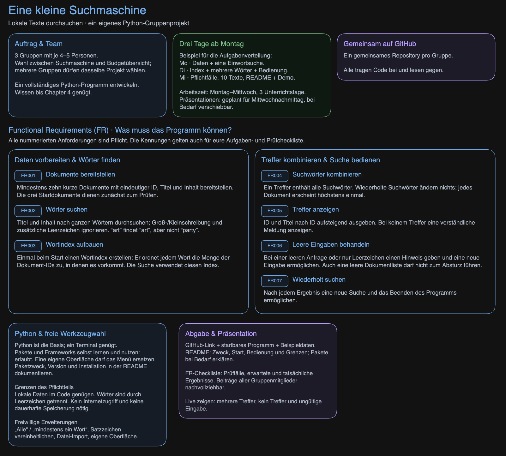

# 🔎 Tolle-Suchmaschine-fuer-WBS

> Python-Projekt für WBS – Quellcode, Aufgabenstellung und Projektunterlagen.

## **📋 Projektüberblick**

Dieses Repository bündelt den Python-Code und die Aufgabenstellung zum Suchmaschinen-Projekt für WBS.

| **Bereich** | **Überblick** |
| :--- | :--- |
| **Projekt** | Tolle-Suchmaschine-fuer-WBS |
| **Repository** | [Impact87ms/Tolle-Suchmaschine-fuer-WBS](https://github.com/Impact87ms/Tolle-Suchmaschine-fuer-WBS) |
| **Programmiersprache** | Python |
| **Hauptdatei** | `Hauptcode v2.py` |
| **Aufgabenstellung** | `Aufgabenstellung.png` |

## **📁 Dateien im Repository**

| **Datei** | **Beschreibung** |
| :--- | :--- |
| [Hauptcode v2.py](Hauptcode%20v2.py) | Python-Hauptdatei des Projekts |
| [Aufgabenstellung.png](Aufgabenstellung.png) | Aufgabenstellung als Bild |
| `README.md` | Projektübersicht und Hinweise zur Nutzung |

## **🚀 Erste Schritte**

### **1. Projekt herunterladen**

Über **Code → Download ZIP** herunterladen oder mit Git klonen:

```bash
git clone https://github.com/Impact87ms/Tolle-Suchmaschine-fuer-WBS.git
cd Tolle-Suchmaschine-fuer-WBS
```

> **Hinweis:** Für das private Repository ist eine entsprechende GitHub-Berechtigung erforderlich.

### **2. Projekt vorbereiten**

- Die [Aufgabenstellung](Aufgabenstellung.png) lesen.
- Die Datei `Hauptcode v2.py` öffnen.
- Benötigte Python-Pakete und Eingabedateien anhand des Quellcodes bereitstellen.

### **3. Programm starten**

Im Projektordner folgenden Befehl ausführen:

```bash
python "Hauptcode v2.py"
```

Je nach Installation stattdessen:

```bash
python3 "Hauptcode v2.py"
```

## **📝 Aufgabenstellung**



## **🛠️ Technische Dokumentation**

Folgende Angaben müssen noch anhand des Quellcodes ergänzt werden:

- [ ] Suchfunktionen und unterstützte Eingabedateien
- [ ] Benötigte Python-Version und zusätzliche Pakete
- [ ] Einstellungen und Dateipfade
- [ ] Beispiel einer Suche mit Ergebnis

---

> **Dokumentationsstand:** Diese Übersicht basiert auf der sichtbaren Dateiliste. Die Funktionsweise des Programms wurde noch nicht anhand des Quellcodes geprüft.
>
> 
**von Ahmed, Lennart, Manuel und Stefan**
